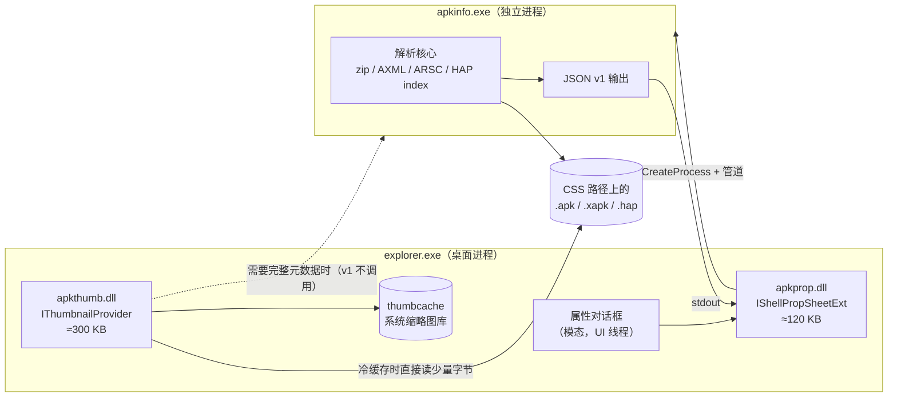

# 架构与接口契约

> 设计理由见 [design.md](design.md)；本文只写"边界在哪、契约是什么"，供实现对照。
> 未标注的接口名均为 Windows Shell 官方接口（`[上游]`）。

## 1. 组件与进程边界



**边界规则**

1. `apkthumb.dll` / `apkprop.dll` 只依赖系统 DLL + 静态 CRT，禁止进入 explorer 的第三方运行时。
2. 全量解析只在 `apkinfo.exe`；两个 DLL 通过"命令行 + 匿名管道"与它通信（不注册 COM LocalServer，避免 surrogate 配置与权限问题）。
3. 缩略图路径**不经过 worker**（v1）：进程启动 ~20 ms 会把"≤300 ms"的预算吃掉一大半；图标解码用 WIC 在 DLL 内完成。这条在 M1 用实测复核，若 PNG/WebP 解码体积超标再议。
4. **缩略图 handler 实际运行在 `dllhost.exe`（COM surrogate）里，输入是 `IInitializeWithStream`**
   `[实测 R-0002]`。因此解析核心只依赖 `ByteSource`（文件 / 流两种实现），不依赖路径；
   属性页（M3）仍在 explorer 内，但同样只做 UI + IPC。

## 2. 产物契约

### 2.1 `apkthumb.dll`

| 项 | 约定 |
| --- | --- |
| 实现接口 | `IThumbnailProvider` + `IInitializeWithStream`（隔离宿主）+ `IInitializeWithItem` / `IInitializeWithFile`（进程内） |
| 导出 | 仅 `DllGetClassObject` / `DllCanUnloadNow`（+ 安装器用的 `DllRegisterServer` / `DllUnregisterServer`，或由脚本写注册表二选一，M1 定：**由 `tools\register.ps1` 写注册表**，DLL 不导出注册函数） |
| CLSID | `{A7C4E1B0-5E8D-4C3A-9F2B-6D1C8E4A7B01}`（勿与 HashTab `{8A56567E-…}`、果核 `{9179448A-…}` 混淆） |
| 支持扩展 | `.apk .xapk .apks .apkm .hap`（v1 定稿）；新增格式只需注册表指向同一 CLSID + 代码里加一个分支（`.aab/.ipa/.appx` 按 [ADR-0006](adr/0006-format-scope-cut.md) 不做） |
| 输出 | `HBITMAP`（32bpp ARGB，`WTSAT_ARGB`）；建议 256×256 源图缩放到请求尺寸 |
| 超时 | 300 ms 软上限：超时/异常返回 `E_FAIL`，Explorer 显示默认图标；同一文件 24 h 内不再重试（失败标记） |
| 缓存 | 自己写 `%LOCALAPPDATA%\apk-shell-ext\thumbs\<sha1(path+size+mtime)>.png`；命中直接解码，不打开原文件 |
| 线程 | Apartment；`GetThumbnail` 在 shell 的工作线程上，仍应自行限制 IO |

**缩略图算法（APK 家族，M1 范围）**

```
1. 读 EOCD → 中央目录（不读本地头）
2. 定位 AndroidManifest.xml 条目 → 只解析到 <application android:icon=…>（AXML）
3. 定位 resources.arsc → 字符串池 + 目标资源 ID 的 type/spec（分段读，见 P3）
4. 候选优先级：mipmap-xxxhdpi > xxhdpi > xhdpi > hdpi > mdpi > 任意 density；
   同时接受 res/drawable-* 与 adaptive icon 的 foreground（M2 起支持合成）
5. 解压该条目 → WIC 解码（PNG/WebP/JPEG）→ 等比缩放、居中、透明底
6. 落自建缓存（失败也落"负缓存"，带 24h 过期）
```

### 2.2 `apkprop.dll`

| 项 | 约定 |
| --- | --- |
| 实现接口 | `IShellPropSheetExt` + `IPersistFile` + **`IShellExtInit`**（M3 实测：这个 build 在建页前先 QI 它，缺了就直接跳过 handler） |
| 注册 | `HKCR\.apk\shellex\PropertySheetHandlers\ApkInfo` 等，按扩展名逐个注册（M4a 起四个扩展名） |
| `AddPages` | ≤ 50 ms：`CreatePropertySheetPage` 后立刻返回；解析任务在 `PSM_INITDIALOG` 之后 `PostMessage` 启动 |
| 页面 | 单页「安装包信息」；顶部大图标 + 应用名；字段分 4 组（应用 / 技术 / 权限与组件 / 文件与签名） |
| 异步 | 工作线程读管道；`WM_APP+1` 回填；页面销毁时置取消标志，线程 detached 且不触碰已销毁 HWND |
| 失败 | 显示具体原因（"不是有效安装包"/"资源表损坏"/"解析超时"），保留"复制诊断信息"按钮 |
| 复制 | 每个字段可右键复制；另有"复制全部为 JSON" |
| DPI/主题 | 原生控件自己跟随系统主题与 DPI；我们只在 `WM_DPICHANGED / WM_SETTINGCHANGE` 时重新向宿主要字体并重排 |

**为什么不用自定义 `IPropertyStore`**：见 ADR-0002。属性页里的字段不参与排序/列，不需要进属性系统。

**M3 实施补充（2026-11-04）**

- 页面是**原生控件组合**（`STATIC` 头 + `SysListView32` 两列 + `BUTTON` 底栏），模板里零控件、代码创建；
  配色/深色/选中/无障碍交给系统（2026-11-04 由全自绘改来，见 `docs/m3-property-page.md` §16）。
- 参数经 `IShellExtInit::Initialize` 的 `CF_HDROP` 与 `IPersistFile::Load` **两条路都接**：前者是这个 build 的必经之路，
  后者保证其它宿主（脚本/测试工具）也能用。
- worker 挂在 `JOB_OBJECT_LIMIT_KILL_ON_JOB_CLOSE` 的 Job 上：页面一关，job 句柄一关，worker 立刻消失；
  取消不等子进程自己退（`TerminateJobObject`）。
- 字段顺序与分组冻结在 [m3-property-page.md §2](m3-property-page.md)；`权限` / `特性` 各自是可折叠分组
  （`LVGS_COLLAPSIBLE | LVGS_COLLAPSED`，默认收起，折叠由系统处理）。
- 分组带依赖 comctl32 v6：`comctl32.dll` 的 `DllGetVersion` 主版本 < 6 时降级为"组标题当普通行"，此时不可折叠。

### 2.3 `apkinfo.exe`（worker）

```
apkinfo.exe --json --schema=1 [--hash=sha256] [--icon=<out.png>] <file>

# M5 起同一个 exe 还带"装好之后"的小工具（不再单独发一个 apkinst.exe，见 ADR-0007）
apkinfo.exe --status                         五个扩展名的注册状态 / 图标路径 / 应用列表条目
apkinfo.exe --diag on|off|status|clear       诊断日志开关与大小
apkinfo.exe --clear-cache [--cache-info]     自建缩略图缓存
apkinfo.exe --lang zh|en|auto                属性页语言（写 HKCU\Software\apk-shell-ext\UiLanguage）
```

| 项 | 约定 |
| --- | --- |
| 输出 | stdout 单个 UTF-8 JSON 对象；stderr 只放诊断；退出码 0 成功 / 2 不是有效包 / 3 超时 / 4 内部错误 |
| 时限 | 默认 8 s 自杀（属性页可传 `--timeout`）；`--hash` 只在属性页请求时计算 |
| 依赖 | 静态 CRT，无运行时依赖；单文件 ≤ 3 MB（目标） |
| 并发 | 每次调用独立进程；不共享状态；缓存只写文件（原子 rename） |
| 安全 | 只读打开源文件（`FILE_SHARE_READ|WRITE|DELETE`）；不解压到临时目录；限额见 [formats.md](formats.md) §4 |

**JSON schema v1（已实现 `file` / `app` / `container` / `icon` / `signature` / `features` / `components` /
`permissions` / `diagnostics`；字段只增不改）**

```json
{
  "schema": 1,
  "kind": "apk",                       // apk | xapk | apks | apkm | splits | hap
  "file": {"path": "D:\\x\\a.apk", "size": 12345678, "mtime": 1762000000,
           "sha256": "…"},              // sha256 仅在 --hash 时出现
  "app": {"package": "com.example.app", "label": "示例应用",
          "versionName": "1.2.3", "versionCode": 123, "minSdk": 26, "targetSdk": 34,
          "compileSdk": 34, "abis": ["arm64-v8a"], "densities": ["xxhdpi"],
          "locales": ["zh-CN", "en"], "installLocation": "auto"},
  "container": {                        // 只在多 APK 容器里出现（M4a）
    "kind": "xapk", "base": "com.example.app.apk", "apkCount": 2,
    "splits": [{"name": "com.example.app.apk", "size": 15812534, "kind": "base", "base": true},
               {"name": "config.armeabi_v7a.apk", "size": 6316540, "kind": "config"}]
  },
  "hap": {                              // 只在鸿蒙 .hap 里出现（M4d）
    "module": "entry", "type": "entry", "mainAbility": "EntryAbility",
    "minAPI": 60000020, "targetAPI": 60000020, "compileSdk": "6.0.0.47",
    "deviceTypes": ["phone"], "abilities": 1, "extensionAbilities": 1,
    "labelRef": "$string:app_name"      // 清单里是资源引用时如实报出，v1 不解析
  },
  "icon": {"source": "res/mipmap-xxhdpi-v4/ic_launcher.png", "width": 144, "height": 144,
           "adaptive": false, "fromContainer": false},   // fromContainer 仅在退到根 icon.png 时出现
  "signature": {"scheme": ["v2", "v3"], "certs": [{"subject": "CN=…", "sha256": "…",
                "notBefore": "2024-01-01T00:00:00Z", "notAfter": "2054-01-01T00:00:00Z"}]},
  "permissions": [{"name": "android.permission.INTERNET", "level": "normal", "declared": true}],
  "components": {"activities": 12, "services": 3, "receivers": 2, "providers": 1},
  "features": [{"name": "android.hardware.camera", "required": true}],
  "diagnostics": {"warnings": ["arsc 未找到，图标按文件名启发式选取"], "elapsedMs": 143}
}
```

`container.splits` 里 `kind` 目前只有三档：`base` / `config`（名字以 `config.` 开头）/ `other`。
所有 `app.*` / `signature` 字段描述的都是**base APK**（v1 不做跨 split 合并），`file.size` 才是外层容器大小。
`.hap` 的 API 号只出现在 `hap.minAPI/targetAPI`：`app.minSdk/targetSdk` 对 HAP 留空，鸿蒙的 API 版本与 Android 的 SDK 不是一回事。

字段只增不改；破坏性变更升 `schema`。缺字段一律省略而不是 `null`，便于 UI 判断。

**`signature` 的语义（M2 落地时的约定）**

- `scheme` 列的是**包里检测到的签名块**（v1 / v2 / v3 / v3.1），**不是"校验通过"**：本阶段不做内容摘要校验，
  所以一个被重打包过、v1 块失效的包仍会显示 `v1`（`.SF` 里 `X-Android-APK-Signed` 声明了 v2 时验证器会跳过 v1）。
  要做"是否可信"必须在 M5 之前另开字段（`verified`），不要偷改 `scheme` 的含义。
- `certs[].sha256` = 证书 DER 的 SHA-256，与 `apksigner verify --print-certs` 的
  `certificate SHA-256 digest` 同源可比；多签名者按 DER 摘要去重。
- `subject` 按 RFC 2253 反向输出（`CN=…, O=…, C=…`）；Windows 与 apksigner 的差别只在属性名写法
  （`E=` vs `EMAILADDRESS=`），不参与任何一致性判定。
- 证书有效期 `notBefore` / `notAfter` 是 ISO-8601 UTC；解析不到就省略。
- 未签名 / 只有坏块的包整体省略 `signature`（不是 `null`）。

**`features`** 只收清单里显式声明的 `uses-feature`（`required` 缺省 true）。
aapt2 会额外打印"隐含特性"（默认 faketouch、屏幕方向、由权限推出的 wifi），那是它自己推的，我们**不**合成。

## 2.4 静态类型图标（M5 已落地，见 [m5-delivery.md §2](m5-delivery.md)）

小图标 / 列表 / 详细信息视图不调用任何代码，用**每个扩展名自己的** `DefaultIcon` 区分格式：

| 扩展名 | 资源 | 说明 |
| --- | --- | --- |
| `.apk` | `icons\apk.ico` | 安卓机器人轮廓 + "APK" |
| `.apks` `.xapk` `.apkm` | `icons\apks.ico` | 同族，标注分包 |
| `.hap` | `icons\hap.ico` | "HAP" |

- 每个 ico 内含 16/24/32/48/256 五档（**每档独立绘制**，不是 256 缩小；48 起才画 "APK"/"XAPK"/"HAP" 字样），
  `DefaultIcon` 只写文件路径（按用户安装是 `"%LOCALAPPDATA%\Programs\apk-shell-ext\icons\apk.ico",0`）。
  图标由 `tools\gen_icons.py` 生成并入库：运行时由 Explorer 直接读文件，构建不依赖 Python。
- **不实现 `IExtractIcon`**（ADR-0001）；`DefaultIcon` 是 Explorer 自己读资源，零调用成本。
- 卸载时随注册表一起还原（先记录原值，若原来无值则删除该键）。

## 3. 缓存

| 缓存 | 位置 | 键 | 失效 | 上限 |
| --- | --- | --- | --- | --- |
| 缩略图 | `%LOCALAPPDATA%\apk-shell-ext\thumbs\` | 文件模式 `sha1(path\|size\|mtime\|解析器版本)`；流模式 `sha1(name\|size\|mtime\|中央目录 SHA-1\|解析器版本)`（ADR-0005） | 文件变化即换键；负缓存 24 h | 200 MB，LRU 清理（每次写入后按总量自检） |
| 元数据 JSON | `…\meta\` | 同上 | 同上 | 50 MB |
| 系统缩略图库 | Explorer 自管 | — | 用户清缓存即失效 | — |

原则：**缓存命中路径不打开原文件**；写入用 `MoveFileEx(REPLACE_EXISTING)` 原子替换，避免半写文件被读到。

## 4. 注册表契约

只注册被支持的扩展名（`.apk` 打样，其余同理；M4a 起默认扩展到 `.apk/.xapk/.apks/.apkm`）：

```
HKCR\.apk\ShellEx\{E357FCCD-A995-4576-B01F-234630154E96}
    (default) = {<ThumbCLSID>}

HKCR\.apk\shellex\PropertySheetHandlers\ApkInfo
    (default) = {<PropCLSID>}

HKCR\CLSID\{<ThumbCLSID>}\(default) = ApkInfo Thumbnail Provider
HKCR\CLSID\{<ThumbCLSID>}\InprocServer32
    (default) = <install dir>\apkthumb.dll
    ThreadingModel = Apartment

HKCR\CLSID\{<PropCLSID>}\(default) = ApkInfo Property Page
HKCR\CLSID\{<PropCLSID>}\InprocServer32
    (default) = <install dir>\apkprop.dll
    ThreadingModel = Apartment

HKCR\.apk\DefaultIcon
    (default) = "<install dir>\icons\apk.ico",0     // M5；纯静态，不加载任何 DLL
```

- **安装形态（M5，[ADR-0007](adr/0007-inno-setup-per-user-install.md)）**：默认按用户装——
  `%LOCALAPPDATA%\Programs\apk-shell-ext` + `HKCU\Software\Classes`，**零 UAC**；勾"为所有用户安装"或 `/ALLUSERS` 时才 `%ProgramFiles%` + `HKLM`，一次 UAC。
  `installer\apk-shell-ext.iss` 里注册表根一律用 `HKA`（整机 = HKLM、按用户 = HKCU），
  `Subkey` 写 `Software\Classes\…`；**不要写 `HKCR`**，非管理员模式会直接写 HKLM
  失败（实测 `RegCreateKeyEx` 代码 5，整个安装回滚）。
- 卸载由 `unins000.exe` 按声明撤销（`uninsdeletevalue` / `uninsdeletekeyifempty`），外加
  `[UninstallDelete]` 清 `%LOCALAPPDATA%\apk-shell-ext\thumbs` 与日志；
  验收用 `tools\verify-install.ps1`（装后断言 + 卸后残留检查 + 快照 diff）。
- 界面语言开关：`HKCU\Software\apk-shell-ext\UiLanguage` = `zh` / `en` /
  缺省（跟随系统），由 `apkinfo --lang` 写。属性页跑在 `explorer.exe` 里，收不到环境变量，
  只能走注册表。
- 不碰 `.apk` 的默认 ProgID / 文件关联（那是"打开方式"的事，与本文无关）。
- 提供 `tools\register.ps1 -Install|-Uninstall -Extensions apk,apks,...` 作为手工入口（免装安装器也能测）。

## 5. 构建与依赖

| 项 | 约定 |
| --- | --- |
| 工具链 | MSVC v143（VS2022 Build Tools）+ CMake ≥ 3.27 |
| 语言 | C++20；不开 RTTI 之外的花活；COM 层用 `wil`（可选）或手写 `ComPtr` |
| UI | `apkprop.dll` 用 WTL（对话框模板）；`apkinfo.exe` 无 UI |
| CRT | `/MT`（静态）；DLL 侧禁止 `/MD` |
| 警告 | `/W4 /WX`；`/guard:cf`、`/DYNAMICBASE`、`/NXCOMPAT` |
| 产物 | `out\x64\{apkthumb.dll, apkprop.dll, apkinfo.exe}` |
| 测试 | `tests\fixtures\` 自造最小包（APK/AAB/IPA/HAP/APPX 各 1–2 个，< 20 KB）；断言走 JSON |

## 6. 失败与安全

| 场景 | 行为 |
| --- | --- |
| 包损坏 / 不是 ZIP | 缩略图返回默认图标；属性页显示"不是有效安装包" |
| ZIP 炸弹 | 条目数 ≤ 65535、单条目解压 ≤ 64 MB、总解压 ≤ 512 MB，超限直接判非法 |
| 路径穿越条目名（`..\`、绝对路径） | 一律不解压到磁盘（只流式读），并对候选名做白名单（`res/`、`base/res/`、`Payload/`、`resources/`） |
| worker 崩溃 | 属性页显示"解析器异常退出（code）"，Explorer 不受影响 |
| 恶意 APK 图标 | 解码走 WIC（系统库，已打补丁），不引入自有 PNG/WebP 解码器（避免重演 libwebp CVE-2023-4863） |
| 杀软误报 | 二进制做 VERSIONINFO + 签名（M5）；不写自启动、不联网、不注入 |
