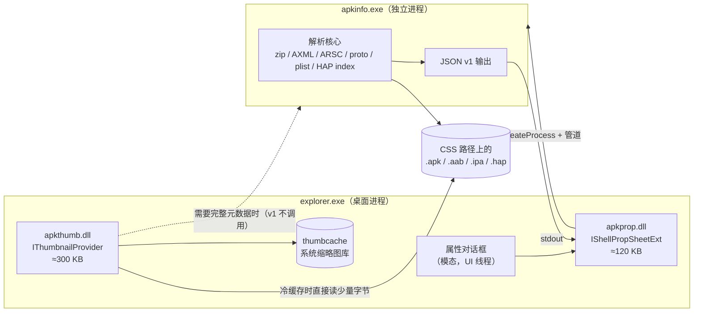

# 架构与接口契约

> 设计理由见 [design.md](design.md)；本文只写"边界在哪、契约是什么"，供实现对照。
> 未标注的接口名均为 Windows Shell 官方接口（`[上游]`）。

## 1. 组件与进程边界



**边界规则**

1. `apkthumb.dll` / `apkprop.dll` 只依赖系统 DLL + 静态 CRT，禁止进入 explorer 的第三方运行时。
2. 全量解析只在 `apkinfo.exe`；两个 DLL 通过"命令行 + 匿名管道"与它通信（不注册 COM LocalServer，避免 surrogate 配置与权限问题）。
3. 缩略图路径**不经过 worker**（v1）：进程启动 ~20 ms 会把"≤300 ms"的预算吃掉一大半；图标解码用 WIC 在 DLL 内完成。这条在 M1 用实测复核，若 PNG/WebP 解码体积超标再议。
4. **缩略图 handler 实际运行在 `dllhost.exe`（COM surrogate）里，输入是 `IInitializeWithStream`**
   `[实测 R-0002]`。因此解析核心只依赖 `ByteSource`（文件 / 流两种实现），不依赖路径；
   属性页（M3）仍在 explorer 内，但同样只做 UI + IPC。

## 2. 产物契约

### 2.1 `apkthumb.dll`

| 项 | 约定 |
| --- | --- |
| 实现接口 | `IThumbnailProvider` + `IInitializeWithStream`（隔离宿主）+ `IInitializeWithItem` / `IInitializeWithFile`（进程内） |
| 导出 | 仅 `DllGetClassObject` / `DllCanUnloadNow`（+ 安装器用的 `DllRegisterServer` / `DllUnregisterServer`，或由脚本写注册表二选一，M1 定：**由 `tools\register.ps1` 写注册表**，DLL 不导出注册函数） |
| CLSID | `{A7C4E1B0-5E8D-4C3A-9F2B-6D1C8E4A7B01}`（勿与 HashTab `{8A56567E-…}`、果核 `{9179448A-…}` 混淆） |
| 支持扩展 | `.apk .apks .xapk .apkm`（v1）；后续加 `.aab .ipa .hap .appx` 只需注册表指向同一 CLSID，代码按扩展分派 |
| 输出 | `HBITMAP`（32bpp ARGB，`WTSAT_ARGB`）；建议 256×256 源图缩放到请求尺寸 |
| 超时 | 300 ms 软上限：超时/异常返回 `E_FAIL`，Explorer 显示默认图标；同一文件 24 h 内不再重试（失败标记） |
| 缓存 | 自己写 `%LOCALAPPDATA%\apk-shell-ext\thumbs\<sha1(path+size+mtime)>.png`；命中直接解码，不打开原文件 |
| 线程 | Apartment；`GetThumbnail` 在 shell 的工作线程上，仍应自行限制 IO |

**缩略图算法（APK 家族，M1 范围）**

```
1. 读 EOCD → 中央目录（不读本地头）
2. 定位 AndroidManifest.xml 条目 → 只解析到 <application android:icon=…>（AXML）
3. 定位 resources.arsc → 字符串池 + 目标资源 ID 的 type/spec（分段读，见 P3）
4. 候选优先级：mipmap-xxxhdpi > xxhdpi > xhdpi > hdpi > mdpi > 任意 density；
   同时接受 res/drawable-* 与 adaptive icon 的 foreground（M2 起支持合成）
5. 解压该条目 → WIC 解码（PNG/WebP/JPEG）→ 等比缩放、居中、透明底
6. 落自建缓存（失败也落"负缓存"，带 24h 过期）
```

### 2.2 `apkprop.dll`

| 项 | 约定 |
| --- | --- |
| 实现接口 | `IShellPropSheetExt` + `IPersistFile`（+ 可选 `IObjectWithSite`） |
| 注册 | `HKCR\.apk\shellex\PropertySheetHandlers\ApkInfo` 等，按扩展名逐个注册 |
| `AddPages` | ≤ 50 ms：`CreatePropertySheetPage` 后立刻返回；解析任务在 `PSM_INITDIALOG` 之后 `PostMessage` 启动 |
| 页面 | 单页「安装包信息」；顶部大图标 + 应用名；字段分 4 组（应用 / 技术 / 权限与组件 / 文件与签名） |
| 异步 | 工作线程读管道；`WM_APP+1` 回填；页面销毁时置取消标志，线程 detached 且不触碰已销毁 HWND |
| 失败 | 显示具体原因（"不是有效安装包"/"资源表损坏"/"解析超时"），保留"复制诊断信息"按钮 |
| 复制 | 每个字段可右键复制；另有"复制全部为 JSON" |
| DPI/主题 | 按 `WM_DPICHANGED` 缩放；深色模式读 `AppsUseLightTheme`，控件用 `SetWindowTheme`/`DwmSetWindowAttribute` |

**为什么不用自定义 `IPropertyStore`**：见 ADR-0002。属性页里的字段不参与排序/列，不需要进属性系统。

### 2.3 `apkinfo.exe`（worker）

```
apkinfo.exe --json --schema=1 [--hash=sha256] [--icon=<out.png>] <file>
```

| 项 | 约定 |
| --- | --- |
| 输出 | stdout 单个 UTF-8 JSON 对象；stderr 只放诊断；退出码 0 成功 / 2 不是有效包 / 3 超时 / 4 内部错误 |
| 时限 | 默认 8 s 自杀（属性页可传 `--timeout`）；`--hash` 只在属性页请求时计算 |
| 依赖 | 静态 CRT，无运行时依赖；单文件 ≤ 3 MB（目标） |
| 并发 | 每次调用独立进程；不共享状态；缓存只写文件（原子 rename） |
| 安全 | 只读打开源文件（`FILE_SHARE_READ|WRITE|DELETE`）；不解压到临时目录；限额见 [formats.md](formats.md) §4 |

**JSON schema v1（草案，M2 冻结）**

```json
{
  "schema": 1,
  "kind": "apk",                       // apk | apks | aab | ipa | hap | appx
  "file": {"path": "D:\\x\\a.apk", "size": 12345678, "mtime": 1762000000,
           "sha256": "…"},              // sha256 仅在 --hash 时出现
  "app": {"package": "com.example.app", "label": "示例应用",
          "versionName": "1.2.3", "versionCode": 123, "minSdk": 26, "targetSdk": 34,
          "compileSdk": 34, "abis": ["arm64-v8a"], "densities": ["xxhdpi"],
          "locales": ["zh-CN", "en"], "installLocation": "auto"},
  "icon": {"source": "res/mipmap-xxhdpi-v4/ic_launcher.png", "width": 144, "height": 144,
           "adaptive": false},
  "signature": {"scheme": ["v2", "v3"], "certs": [{"subject": "CN=…", "sha256": "…",
                "notBefore": "2024-01-01T00:00:00Z", "notAfter": "2054-01-01T00:00:00Z"}]},
  "permissions": [{"name": "android.permission.INTERNET", "level": "normal", "declared": true}],
  "components": {"activities": 12, "services": 3, "receivers": 2, "providers": 1},
  "features": [{"name": "android.hardware.camera", "required": true}],
  "splits": [{"name": "base", "size": 123}, {"name": "config.arm64_v8a", "size": 45}],
  "diagnostics": {"warnings": ["arsc 未找到，图标按文件名启发式选取"], "elapsedMs": 143}
}
```

字段只增不改；破坏性变更升 `schema`。缺字段一律省略而不是 `null`，便于 UI 判断。

## 2.4 静态类型图标（M5）

小图标 / 列表 / 详细信息视图不调用任何代码，用**每个扩展名自己的** `DefaultIcon` 区分格式：

| 扩展名 | 资源 | 说明 |
| --- | --- | --- |
| `.apk` | `icons\apk.ico` | 安卓机器人轮廓 + "APK" |
| `.apks` `.xapk` `.apkm` | `icons\apks.ico` | 同族，标注分包 |
| `.aab` | `icons\aab.ico` | "AAB" |
| `.ipa` | `icons\ipa.ico` | 苹果轮廓 + "IPA" |
| `.hap` | `icons\hap.ico` | "HAP" |
| `.appx` `.msix` | `icons\appx.ico` | "APPX" |

- 每个 ico 内含 16/24/32/48/256 五档，`DefaultIcon` 只写文件路径（`"%ProgramFiles%\apk-shell-ext\icons\apk.ico",0`）。
- **不实现 `IExtractIcon`**（ADR-0001）；`DefaultIcon` 是 Explorer 自己读资源，零调用成本。
- 卸载时随注册表一起还原（先记录原值，若原来无值则删除该键）。

## 3. 缓存

| 缓存 | 位置 | 键 | 失效 | 上限 |
| --- | --- | --- | --- | --- |
| 缩略图 | `%LOCALAPPDATA%\apk-shell-ext\thumbs\` | 文件模式 `sha1(path\|size\|mtime\|解析器版本)`；流模式 `sha1(name\|size\|mtime\|中央目录 SHA-1\|解析器版本)`（ADR-0005） | 文件变化即换键；负缓存 24 h | 200 MB，LRU 清理（每次写入后按总量自检） |
| 元数据 JSON | `…\meta\` | 同上 | 同上 | 50 MB |
| 系统缩略图库 | Explorer 自管 | — | 用户清缓存即失效 | — |

原则：**缓存命中路径不打开原文件**；写入用 `MoveFileEx(REPLACE_EXISTING)` 原子替换，避免半写文件被读到。

## 4. 注册表契约

只注册被支持的扩展名（`.apk` 打样，其余同理）：

```
HKCR\.apk\ShellEx\{E357FCCD-A995-4576-B01F-234630154E96}
    (default) = {<ThumbCLSID>}

HKCR\.apk\shellex\PropertySheetHandlers\ApkInfo
    (default) = {<PropCLSID>}

HKCR\CLSID\{<ThumbCLSID>}\(default) = ApkInfo Thumbnail Provider
HKCR\CLSID\{<ThumbCLSID>}\InprocServer32
    (default) = <install dir>\apkthumb.dll
    ThreadingModel = Apartment

HKCR\CLSID\{<PropCLSID>}\(default) = ApkInfo Property Page
HKCR\CLSID\{<PropCLSID>}\InprocServer32
    (default) = <install dir>\apkprop.dll
    ThreadingModel = Apartment

HKCR\.apk\DefaultIcon
    (default) = "<install dir>\icons\apk.ico",0     // M5；纯静态，不加载任何 DLL
```

- 写 `HKLM` 需要管理员：安装器一次 UAC；卸载时**精确删除自己写过的键**（不 `reg delete /f` 整个类型）。
- 不碰 `.apk` 的默认 ProgID / 文件关联（那是"打开方式"的事，与本文无关）。
- 提供 `tools\register.ps1 -Install|-Uninstall -Extensions apk,apks,...` 作为手工入口（免装安装器也能测）。

## 5. 构建与依赖

| 项 | 约定 |
| --- | --- |
| 工具链 | MSVC v143（VS2022 Build Tools）+ CMake ≥ 3.27 |
| 语言 | C++20；不开 RTTI 之外的花活；COM 层用 `wil`（可选）或手写 `ComPtr` |
| UI | `apkprop.dll` 用 WTL（对话框模板）；`apkinfo.exe` 无 UI |
| CRT | `/MT`（静态）；DLL 侧禁止 `/MD` |
| 警告 | `/W4 /WX`；`/guard:cf`、`/DYNAMICBASE`、`/NXCOMPAT` |
| 产物 | `out\x64\{apkthumb.dll, apkprop.dll, apkinfo.exe}` |
| 测试 | `tests\fixtures\` 自造最小包（APK/AAB/IPA/HAP/APPX 各 1–2 个，< 20 KB）；断言走 JSON |

## 6. 失败与安全

| 场景 | 行为 |
| --- | --- |
| 包损坏 / 不是 ZIP | 缩略图返回默认图标；属性页显示"不是有效安装包" |
| ZIP 炸弹 | 条目数 ≤ 65535、单条目解压 ≤ 64 MB、总解压 ≤ 512 MB，超限直接判非法 |
| 路径穿越条目名（`..\`、绝对路径） | 一律不解压到磁盘（只流式读），并对候选名做白名单（`res/`、`base/res/`、`Payload/`、`resources/`） |
| worker 崩溃 | 属性页显示"解析器异常退出（code）"，Explorer 不受影响 |
| 恶意 APK 图标 | 解码走 WIC（系统库，已打补丁），不引入自有 PNG/WebP 解码器（避免重演 libwebp CVE-2023-4863） |
| 杀软误报 | 二进制做 VERSIONINFO + 签名（M5）；不写自启动、不联网、不注入 |
